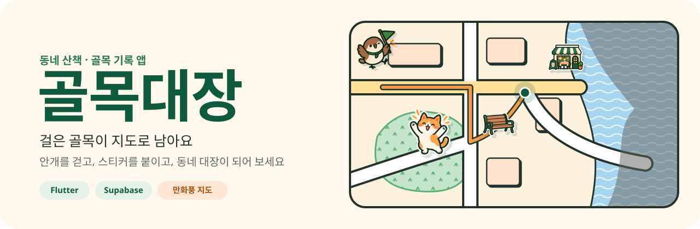
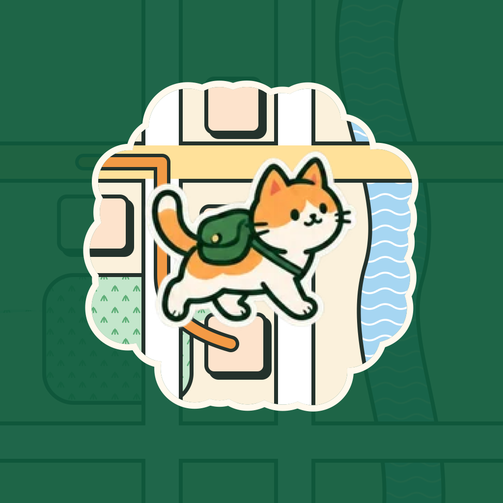

<p align="center">
  
</p>

<p align="center">
  <a href="https://github.com/Ryu-Ji-Whan/golmok_flutter/actions/workflows/build.yml"></a>
  <a href="https://github.com/Ryu-Ji-Whan/golmok_flutter/releases/latest"></a>
  
  
</p>

<p align="center"><b>동네 골목을 걸으면 안개가 걷히고, 마음에 드는 곳엔 스티커를 붙여 나만의 지도를 만드는 산책 앱이에요.</b></p>

<p align="center">
  <a href="https://ryu-ji-whan.github.io/golmok_flutter/design/"></a>
</p>

---

## 📲 바로 써 보기

| 기기 | 방법 |
|---|---|
| **Android** | [최신 빌드](https://github.com/Ryu-Ji-Whan/golmok_flutter/releases/latest)에서 `golmok-flutter.apk`를 받아 설치 |
| **iPhone** | 같은 곳에서 `golmok-flutter-unsigned.ipa`를 받아 PC의 [Sideloadly](https://sideloadly.io)로 내 Apple ID 서명 후 설치 |

> 책상에서도 시험할 수 있어요. 산책을 시작한 뒤 **데모 걷기**를 켜면 1초에 8m씩 걷는 흉내를 내요.

## ✨ 이런 앱이에요

<table>
  <tr>
    <td align="center" width="25%"><br><b>안개 걷기</b><br><sub>걸은 골목 주변 150m의<br>안개가 걷혀요</sub></td>
    <td align="center" width="25%"><br><b>스티커 기록</b><br><sub>고양이 벤치, 골목 책방…<br>지금 자리에 붙여요</sub></td>
    <td align="center" width="25%"><br><b>스탬프 투어</b><br><sub>동네 캠페인 스팟을 돌고<br>한정 스티커를 받아요</sub></td>
    <td align="center" width="25%"><br><b>동네 대장</b><br><sub>이번 주 밝힌 칸으로<br>이웃과 순위를 겨뤄요</sub></td>
  </tr>
</table>

## 🗺️ 화면 구성

**온보딩 → 로그인 → 회원가입 4단계 (약관 · 닉네임 · 캐릭터 · 위치/동네) → 가입 완료 → 아래 탭 5개**

| 🚶 산책 | 🗺️ 내 지도 | 💬 피드 | 🏆 동네 | 🛍️ 상점 |
|---|---|---|---|---|
| 지도 · 산책 시작/끝<br>여기 기록하기<br>산책 요약 | 밝힌 골목 · 지난 경로<br>기록 목록 → 저장된 기록<br>→ 피드에 공유 | 이웃이 공유한 기록<br>좋아요 | 이번 주 리더보드<br>대장 보상 | 스티커 팩<br>스탬프 투어<br>제휴 가게 · 쿠폰 |

그 밖에 **프로필** (닉네임·캐릭터 바꾸기, 스티커 보관함, 로그아웃)

| 흐름 | 화면 파일 |
|---|---|
| 온보딩 · 로그인 · 이메일 계정 | [`onboarding.dart`](lib/screens/onboarding.dart) · [`login.dart`](lib/screens/login.dart) · [`email_auth.dart`](lib/screens/email_auth.dart) |
| 회원가입 (약관~가입 완료) | [`signup.dart`](lib/screens/signup.dart) |
| 산책 지도 · 산책 요약 | [`walk.dart`](lib/screens/walk.dart) |
| 스티커 붙여 기록 · 사진 넣기 | [`record.dart`](lib/screens/record.dart) |
| 내 지도 · 저장된 기록 · 공유 | [`mymap.dart`](lib/screens/mymap.dart) · [`spot_detail.dart`](lib/screens/spot_detail.dart) |
| 골목 피드 · 동네 리더보드 | [`feed.dart`](lib/screens/feed.dart) · [`town.dart`](lib/screens/town.dart) |
| 스티커 상점 · 스탬프 투어 · 제휴 가게 | [`shop.dart`](lib/screens/shop.dart) · [`campaign.dart`](lib/screens/campaign.dart) · [`stores.dart`](lib/screens/stores.dart) |
| 프로필 · 설정 | [`profile.dart`](lib/screens/profile.dart) |

## 🎨 디자인 시스템

### 색

| | 이름 | 값 | 쓰는 곳 |
|---|---|---|---|
|  | 포레스트 | `#0E5A3C` | 주 버튼, 제목 |
|  | 리프 | `#2F8A61` | 아이콘, 링크 |
|  | 민트 | `#E4F2E8` | 칩, 배지 바탕 |
|  | 크림 | `#FFF9ED` | 화면 바탕 |
|  | 오렌지 | `#F39A45` | 강조 면, 산책 경로 |
|  | 피치 | `#FDE7D3` | 캐릭터 원, 쿠폰 |
|  | 핑크 | `#EE7C8B` | 좋아요 |
|  | 잉크 | `#24322C` | 본문 글자, 지도 외곽선 |
|  | 뮤트 | `#5E6A63` | 보조 글자 |
|  | 선 | `#E3DCCB` | 테두리, 비활성 버튼 |

### 글꼴 · 모양

- **제목** — [Jua](https://fonts.google.com/specimen/Jua) (44 / 26 / 22) · **본문** — 기기 기본 한글 글꼴 (17 · 15 · 14 · 13 · 12)
- **모서리** — 입력창 14 · 카드 18 · 큰 카드 22 · 바텀시트 28 · 버튼은 알약 모양
- **그림자** — 카드 `0 4 12 잉크 12%` · 주 버튼 `0 6 14 포레스트 25%`

### 만화풍 지도

무료 지도 데이터([OpenStreetMap](https://www.openstreetmap.org) · [OpenFreeMap](https://openfreemap.org))에 직접 만든 스타일을 입혔어요.
파스텔 색 + 굵은 잉크 외곽선 + 건물 그림자 + 물결·풀 무늬 + 손그림처럼 살짝 흔들리는 선. 대한민국 어디서나 같은 스타일로 그려져요.

<p>
  
</p>
<sub>스티커 55종 · <a href="assets/map/stickers">전체 보기</a></sub>

## 🙌 디자인 도움이 필요한 곳

- [ ] **앱 아이콘 다듬기 · 시작 화면** — 임시 아이콘(, 원본 `assets/icon/icon.svg`)이 들어가 있어요
- [ ] **사진 꾸미기** — 사진 위에 스티커 여러 개 붙이기, 갤러리 저장, SNS 공유
- [ ] **지도 꾸미기** — 내 지도를 꾸며서 한 장으로 남기기
- [ ] **빈 화면 · 오류 화면** — 기록이 없을 때, 위치 권한이 없을 때, 인터넷이 끊겼을 때
- [ ] **지도 스타일 다듬기** — 색, 선 두께, 지명 글자 크기
- [ ] **스티커 추가** — 계절·동네 한정 스티커

### 디자인을 바꾸면 반영되는 곳

| 바꿀 것 | 파일 |
|---|---|
| 앱 색 · 모서리 · 그림자 | [`lib/theme.dart`](lib/theme.dart) |
| 버튼 · 카드 · 배지 같은 공통 부품 | [`lib/widgets/ui.dart`](lib/widgets/ui.dart) |
| 지도 색 · 선 · 무늬 | [`assets/map/cartoon_map.html`](assets/map/cartoon_map.html) 안의 `C = { … }` |
| 스티커 그림 (webp, 정사각형) | [`assets/map/stickers/`](assets/map/stickers) |
| 스티커 이름 · 분류 | [`lib/data/stickers.dart`](lib/data/stickers.dart) |

## 🛠️ 개발자용

<details>
<summary>구조와 빌드 방법</summary>

- **지도** — `assets/map/cartoon_map.html` (MapLibre GL JS)을 WebView로 띄우고 `lib/widgets/cartoon_map.dart`에서 안개·경로·스티커를 보낸다
- **폰 안 데이터베이스** — SQLite (`lib/data/db.dart`). 오프라인에서도 기록이 남는다
- **서버** — Supabase (`lib/data/remote.dart`, 표 구조 `supabase/schema.sql`). 이메일 계정, 기록 동기화, 피드, 리더보드
- **상태** — `lib/data/store.dart` (저장할 때마다 폰 DB → 서버 순서로 올림)
- **빌드** — `main`에 올리면 GitHub Actions가 `android/`·`ios/` 폴더를 새로 만들고 APK·IPA를 [Releases](https://github.com/Ryu-Ji-Whan/golmok_flutter/releases)에 올린다

내 컴퓨터에서 돌리기:

```bash
flutter create --platforms=android,ios --org kr.golmok --project-name golmok_flutter .
rm test/widget_test.dart
flutter run
```

위치 권한 문구는 `.github/workflows/build.yml`의 "Generate native" 단계를 참고해 넣는다.

</details>

---

<p align="center"><sub>지도 데이터 © OpenStreetMap 기여자 · 타일 OpenFreeMap · 글꼴 Jua (SIL OFL)</sub></p>
