<p align="center">
  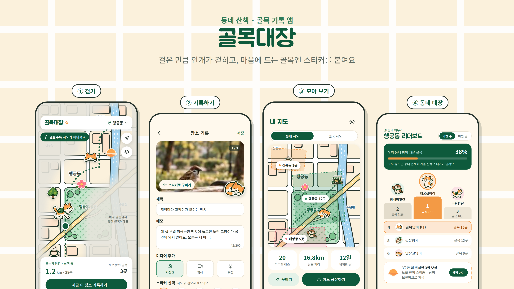
</p>

<p align="center">
  <a href="https://github.com/Ryu-Ji-Whan/golmok_flutter/releases/latest"></a>
  
  
  <a href="https://github.com/Ryu-Ji-Whan/golmok_flutter/actions/workflows/build.yml"></a>
</p>

<h3 align="center">매일 걷는 동네, 아직 안 가 본 골목이 더 많지 않나요?</h3>

<p align="center">
<b>골목대장</b>은 걸은 만큼 동네 지도의 안개가 걷히는 산책 앱이에요.<br>
마음에 드는 골목엔 스티커와 사진을 붙여 두고, 같은 동네 사람들과 이번 주 누가 더 많이 걸었는지 겨뤄 보세요.
</p>

<p align="center">
  <a href="https://github.com/Ryu-Ji-Whan/golmok_flutter/releases/latest"></a>
  <a href="https://ryu-ji-whan.github.io/golmok_flutter/design/"></a>
</p>

---

## 📱 화면 미리보기

<table>
  <tr>
    <td align="center" width="25%">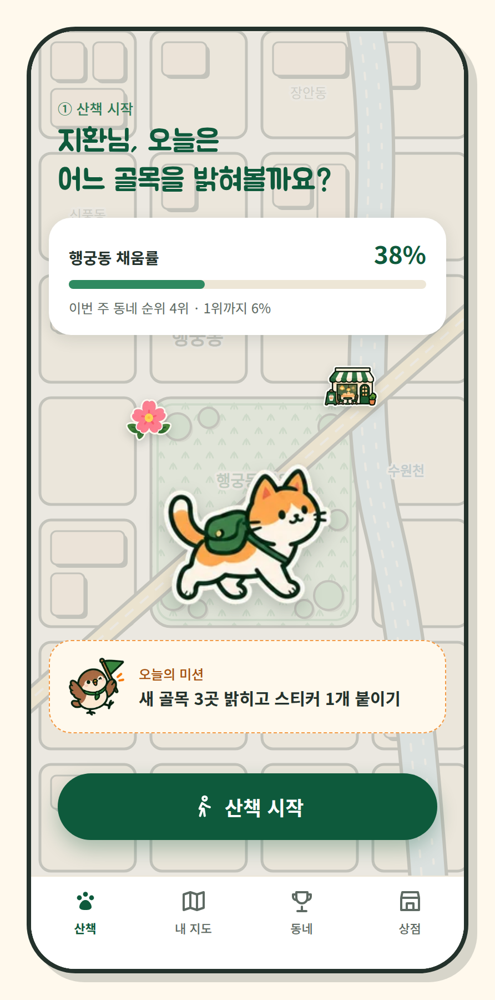<br><b>산책 시작</b><br><sub>오늘의 미션과 동네 채움률</sub></td>
    <td align="center" width="25%">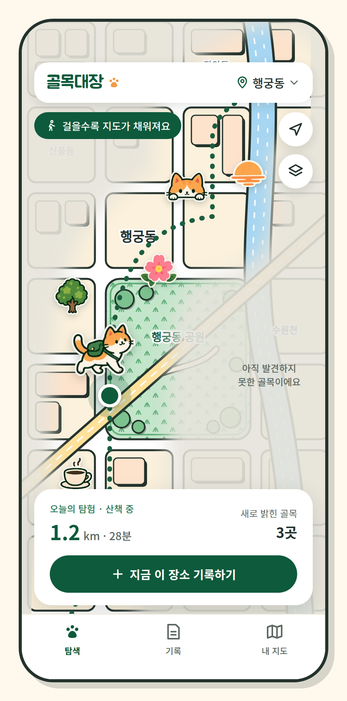<br><b>산책 중 지도</b><br><sub>걸은 길과 걷힌 안개</sub></td>
    <td align="center" width="25%">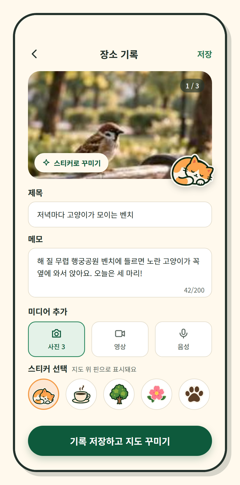<br><b>장소 기록</b><br><sub>사진·메모·스티커</sub></td>
    <td align="center" width="25%">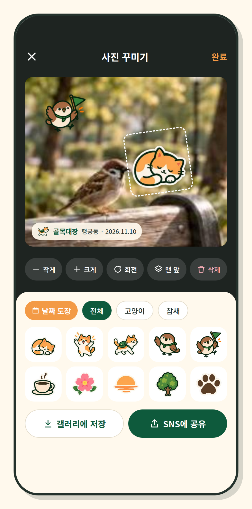<br><b>사진 꾸미기</b><br><sub>사진 위에 스티커</sub></td>
  </tr>
  <tr>
    <td align="center" width="25%">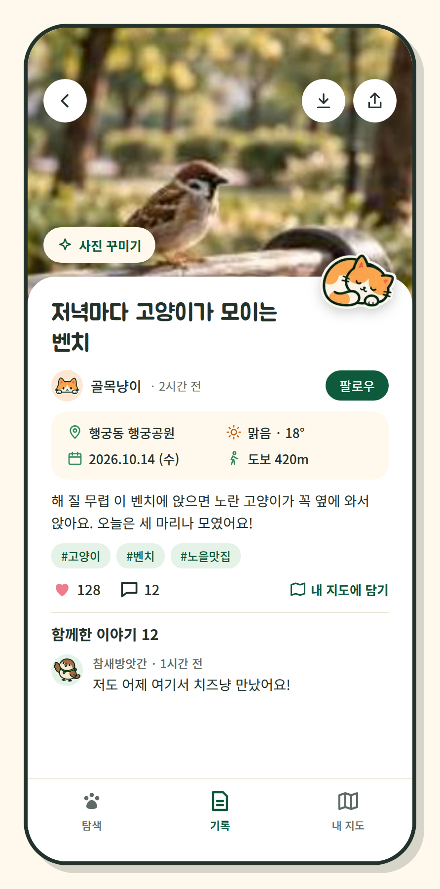<br><b>저장된 기록</b><br><sub>남긴 장소 다시 보기</sub></td>
    <td align="center" width="25%">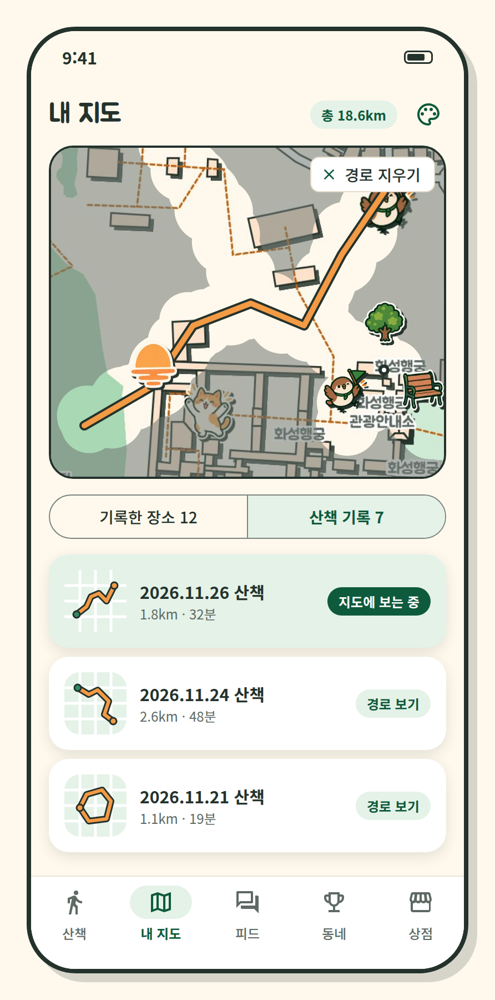<br><b>내 지도</b><br><sub>동네별로 모아 보기</sub></td>
    <td align="center" width="25%">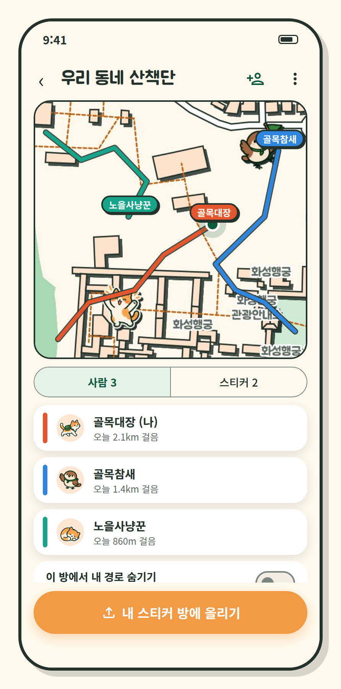<br><b>친구 방</b><br><sub>오늘 걸은 길을 함께</sub></td>
    <td align="center" width="25%">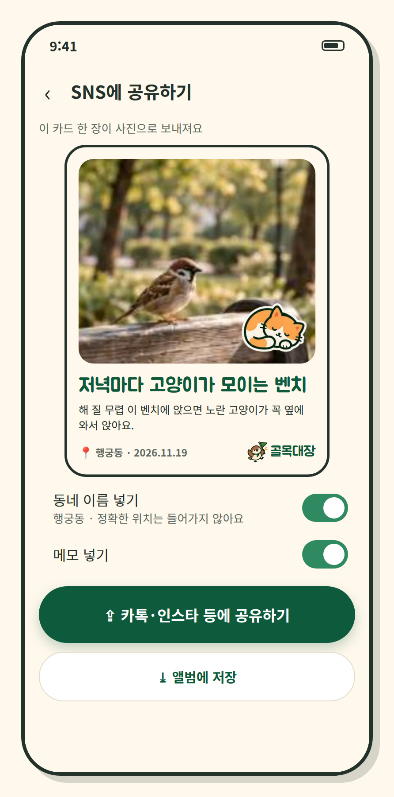<br><b>카드 사진으로 공유</b><br><sub>카톡·인스타로</sub></td>
  </tr>
  <tr>
    <td align="center" width="25%">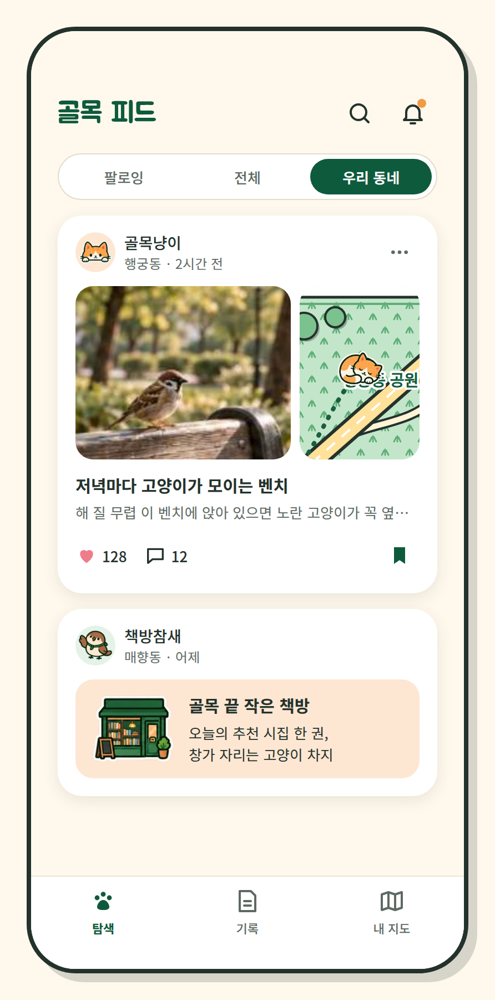<br><b>골목 피드</b><br><sub>이웃이 나눈 골목</sub></td>
    <td align="center" width="25%">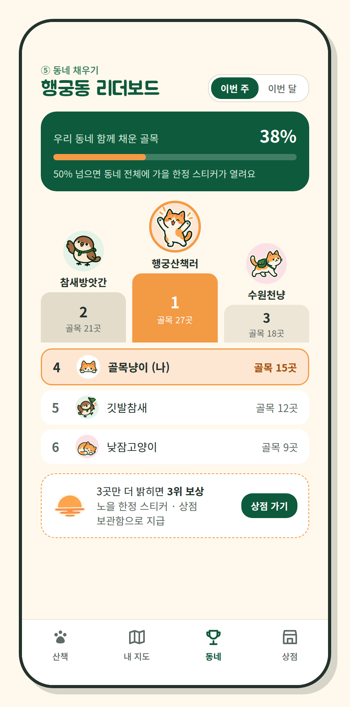<br><b>동네 리더보드</b><br><sub>이번 주 동네 대장</sub></td>
    <td align="center" width="25%">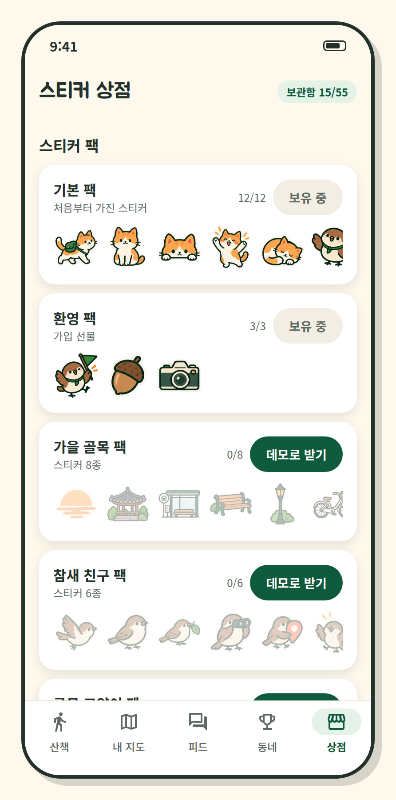<br><b>스티커 상점</b><br><sub>팩 모으기</sub></td>
    <td align="center" width="25%">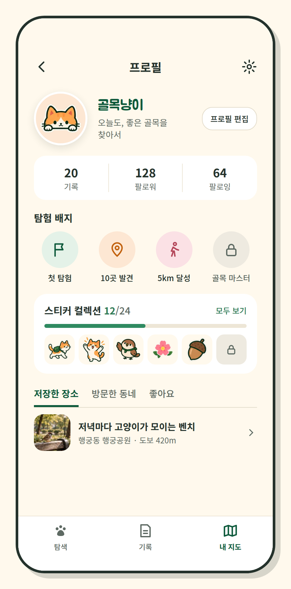<br><b>프로필</b><br><sub>스티커 보관함·설정</sub></td>
  </tr>
  <tr>
    <td align="center" width="25%">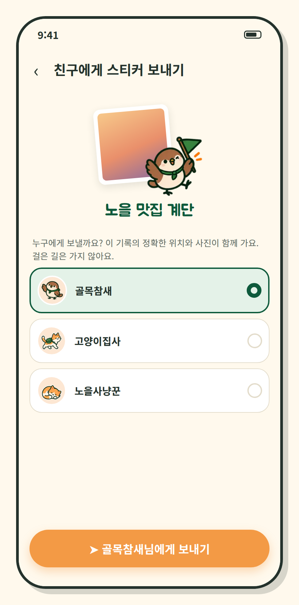<br><b>스티커 보내기</b><br><sub>친구에게 슝~</sub></td>
    <td align="center" width="25%">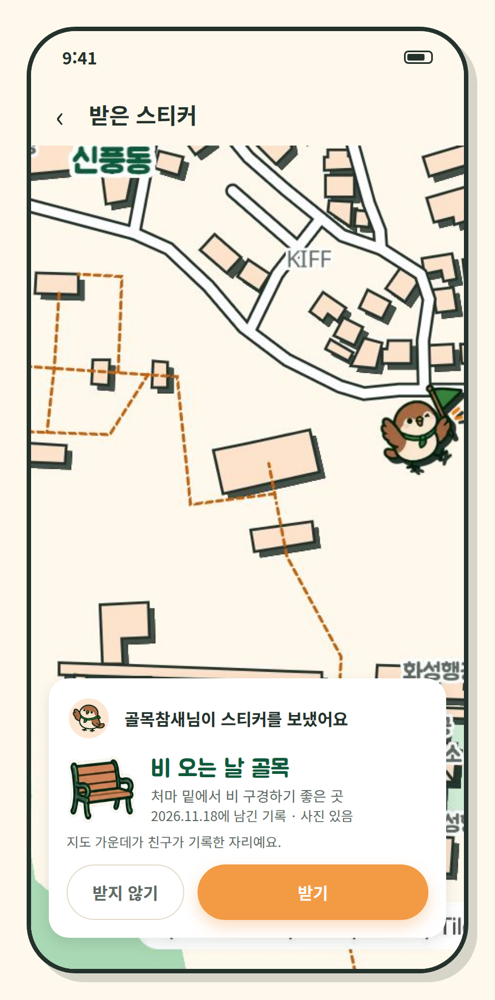<br><b>받은 스티커</b><br><sub>내 지도에 콩!</sub></td>
    <td align="center" width="25%">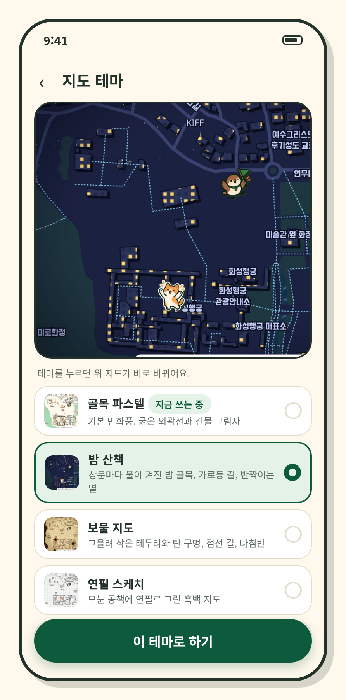<br><b>지도 테마</b><br><sub>7가지 중에 골라요</sub></td>
    <td align="center" width="25%">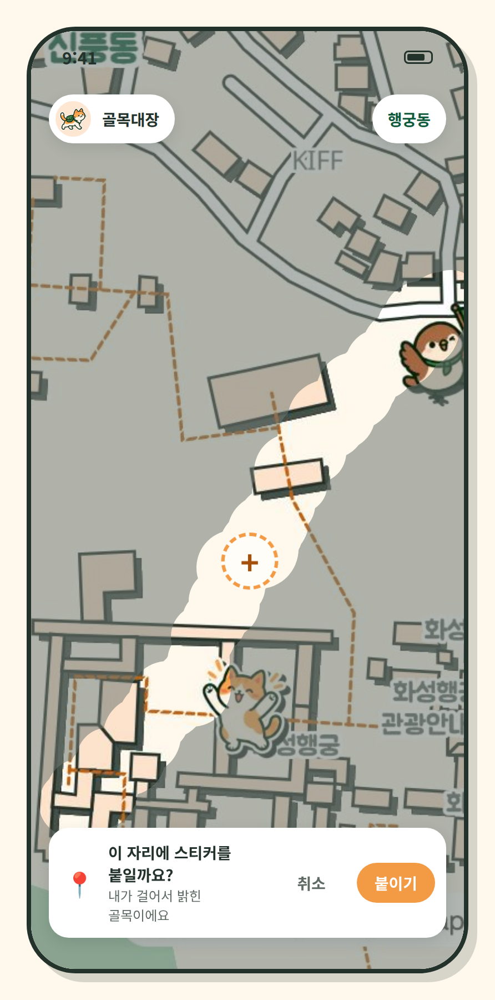<br><b>밝힌 곳에 붙이기</b><br><sub>지도를 눌러 나중에</sub></td>
  </tr>
</table>

<sub>디자인 시안 화면이에요. 실제 앱은 조금씩 다를 수 있어요 · <a href="https://ryu-ji-whan.github.io/golmok_flutter/design/">화면 33개 직접 눌러 보기</a></sub>

## ✨ 이런 걸 할 수 있어요

<table>
  <tr>
    <td align="center" width="33%"><br><b>걸으면 안개가 걷혀요</b><br><sub>처음엔 동네가 안개에 덮여 있어요.<br>걸은 골목 주변 40m가 동글동글 밝아져요.</sub></td>
    <td align="center" width="33%"><br><b>골목에 스티커를 붙여요</b><br><sub>고양이 벤치, 작은 책방, 노을 언덕…<br>사진을 찍어 그 자리에 남겨요.</sub></td>
    <td align="center" width="33%"><br><b>동네 대장에 도전해요</b><br><sub>실제로 걸은 동네에서<br>이번 주 걸은 거리로 순위를 겨뤄요.</sub></td>
  </tr>
  <tr>
    <td align="center"><br><b>골목 피드</b><br><sub>마음에 든 장소를 이웃과 나눠요.<br>정확한 위치는 보이지 않아요.</sub></td>
    <td align="center"><br><b>스티커 모으기</b><br><sub>고양이·참새·골목 풍경 스티커 55종.<br>가입 선물과 동네 대장 한정 스티커도 있어요.</sub></td>
    <td align="center"><br><b>내 산책 기록</b><br><sub>산책마다 걸은 경로 그림과 거리·시간이 남아<br>내 지도로 한눈에 모아 봐요.</sub></td>
  </tr>
  <tr>
    <td align="center"><br><b>사진 꾸미기</b><br><sub>사진 위에 스티커와 날짜 도장을 붙이고<br>앨범에 저장하거나 SNS에 공유해요.</sub></td>
    <td align="center"><br><b>친구 방</b><br><sub>친구들과 방을 만들어 오늘 걸은 길과<br>스티커를 함께 봐요. 한 방 최대 10명.</sub></td>
    <td align="center"><br><b>아이디·비밀번호 찾기</b><br><sub>가입한 이메일로 링크를 받아<br>아이디 확인과 새 비밀번호 설정.</sub></td>
  </tr>
  <tr>
    <td align="center"><br><b>친구</b><br><sub>아이디·닉네임으로 친구를 추가하고<br>요청을 수락해 친구가 돼요.</sub></td>
    <td align="center"><br><b>스티커 보내기</b><br><sub>기록을 친구에게 보내면 슝 날아가고,<br>친구가 받으면 그 자리에 콩 붙어요.</sub></td>
    <td align="center"><br><b>지도 테마 7가지</b><br><sub>파스텔·밤 산책·보물 지도·연필 스케치·<br>수채화·벚꽃·레트로 게임. 앱 색·글씨체도 같이 바뀌어요.</sub></td>
  </tr>
</table>

### 🗺️ 만화풍 지도

전국 어디서나 동화책 같은 지도로 그려져요. 파스텔 색에 굵은 외곽선, 건물 그림자, 물결과 풀 무늬.
→ [지도 직접 움직여 보기](https://ryu-ji-whan.github.io/golmok_flutter/design/#map)

## 👟 이렇게 써요

1. **가입하기** — 아이디·비밀번호·이메일로 가입하거나 카카오로 시작해요. 로그인 없이 둘러볼 수도 있어요.
2. **내 동네 정하기** — 주로 생활하는 동네를 검색하거나, 현재 위치로 찾아요. (전국 어느 동이든)
3. **산책 시작** — 지도에서 **산책 시작**을 누르고 걸어요. 걸은 길이 주황 선으로 그려지고 안개가 걷혀요.
4. **여기 기록하기** — 마음에 드는 곳에서 스티커를 고르고 사진·메모를 남겨요. 이미 걸어서 밝힌 골목은 지도에서 그 자리를 눌러 나중에 붙일 수도 있어요. **스티커로 꾸미기**로 사진 위에 스티커와 날짜 도장도 붙여요.
5. **산책 끝내기** — 오늘 걸은 경로 그림과 거리가 나와요. 기록은 내 지도에 쌓여요.
6. **친구에게 스티커 보내기** — 프로필의 **친구**에서 아이디·닉네임으로 친구를 추가하고, 저장된 기록에서 친구를 골라 보내요. 친구가 **받기**를 누르면 스티커가 날아와 친구 지도의 그 자리에 콩 붙어요. 카톡·인스타로는 **카드 사진으로 공유하기**를 써요.
7. **내 지도** — 기록한 장소를 누르면 지도가 그 자리로 크게 확대돼요. 산책 기록을 누르면 **그 산책의 경로만** 지도에 그려져요. 🎨 버튼(또는 프로필 → 지도 테마)으로 지도 테마도 바꿔요.
8. **동네 탭 → 친구 방** — 방을 만들고 6자리 코드를 보내거나 골목대장 친구를 바로 초대해요. 방 지도에는 사람마다 다른 색으로 **오늘 걸은 길**이 그려지고, 각자 올린 스티커가 붙어요.
9. **동네 탭 → 리더보드** — 지금 있는 동네, 내 동네, 이번 주 걸은 동네마다 내 순위를 확인해요.

## 🏆 동네 리더보드는 이렇게 정해져요

- **실제로 걸은 동네 기준** — 수원 행궁동을 걸으면 행궁동 순위에, 서울 연남동을 걸으면 연남동 순위에 들어가요.
- **동(읍·면) 단위**, 순위는 **최근 7일 동안 그 동네에서 걸은 거리**예요.
- **내 동네**는 가입할 때 정한 주 생활 동네예요. 동네 대장 한정 스티커는 내 동네에서만 받을 수 있어요.
- 리더보드가 부담스러우면 **"리더보드에 내 이름 숨기기"**를 켜면 돼요.

## 🔒 내 위치는 이렇게 지켜요

| 무엇 | 누가 볼 수 있나요 |
|---|---|
| 걸은 경로, 정확한 위치 | **나만** (내 폰과 내 계정). 예외: 내가 들어간 친구 방 사람들 |
| 친구 방 | **그 방 사람만** — 오늘(밤 12시까지) 걸은 경로와 방에 올린 스티커(위치·제목·메모). 방마다 내 경로 숨기기 가능, 방을 나가면 올린 스티커도 지워져요 |
| 피드에 공유한 기록 | 이웃 — 스티커·제목·메모·동네 이름만, **좌표는 안 보여요** |
| 리더보드 | 이웃 — 닉네임과 걸은 거리만 (숨기기 가능) |
| 사진 | 내 폰에 저장돼요. 친구에게 스티커를 보낼 때만 그 사진이 서버를 거쳐 그 친구에게 가요 (받거나 거절하면 서버에서 지워요) |
| 친구에게 보낸 스티커 | **그 친구만** — 그 기록 한 곳의 정확한 위치·스티커·제목·메모·사진. **걸은 경로는 안 가요.** 받은 순간부터 친구의 기록이에요 |
| 카드 사진으로 공유 | 받은 사람 — 사진·스티커·제목·메모(끌 수 있음)·동 이름(끌 수 있음)·날짜, **좌표는 없어요** |
| 친구 찾기 | 아이디나 닉네임을 **정확히** 입력해야만 찾을 수 있어요 (목록으로 훑어볼 수 없어요) |

로그인하면 기록이 내 계정에 저장돼서 폰을 바꿔도 이어져요. 로그인 없이 쓰면 이 폰에만 남아요.

## 📲 설치하기

| 기기 | 방법 |
|---|---|
| **Android** | [최신 버전](https://github.com/Ryu-Ji-Whan/golmok_flutter/releases/latest)에서 `golmok-flutter.apk`를 받아 설치 (출처를 알 수 없는 앱 설치 허용 필요) |
| **iPhone** | 같은 곳에서 `golmok-flutter-unsigned.ipa`를 받아 컴퓨터의 [Sideloadly](https://sideloadly.io)로 내 Apple ID로 설치 (무료 계정은 7일마다 다시 설치) |

> 아직 앱스토어·플레이스토어에 올리기 전인 **미리보기 버전**이에요. 책상에서 시험해 보려면 산책 중에 **데모 걷기**를 켜 보세요.

## 🛣️ 앞으로

- [x] 사진 꾸미기 — 사진 위에 스티커 여러 개 붙이고 저장·공유
- [x] 아이디·비밀번호 찾기
- [x] 기록을 스티커 카드 한 장으로 친구에게 보내기
- [x] 친구 추가, 친구에게 스티커 보내기 (날아가서 콩 붙기)
- [x] 지도 테마 7가지
- [x] 친구 방 — 오늘 걸은 길과 스티커를 방 사람끼리 함께 보기
- [ ] 링크로 기록 공유 (친구가 웹·앱에서 바로 열어 보기)
- [ ] 사진을 내 계정에 저장 (폰을 바꿔도 유지)
- [ ] Google · Apple 로그인
- [ ] 앱스토어 · 플레이스토어 출시

---

<details>
<summary><b>🎨 디자인</b> — 색, 글꼴, 디자인 시안, 바꾸는 곳</summary>

<br>

**디자인 시안 사이트:** 화면 33개, 디자인 시스템, 움직이는 만화풍 지도 → [ryu-ji-whan.github.io/golmok_flutter/design](https://ryu-ji-whan.github.io/golmok_flutter/design/)

| | 이름 | 값 | 쓰는 곳 |
|---|---|---|---|
|  | 포레스트 | `#0E5A3C` | 주 버튼, 제목 |
|  | 리프 | `#2F8A61` | 아이콘, 링크 |
|  | 크림 | `#FFF9ED` | 화면 바탕 |
|  | 오렌지 | `#F39A45` | 강조, 산책 경로 |
|  | 잉크 | `#24322C` | 글자, 지도 외곽선 |

- **글꼴** — 제목 [Jua](https://fonts.google.com/specimen/Jua), 본문 기기 기본 한글 글꼴
- **모서리** — 입력창 14 · 카드 18 · 큰 카드 22 · 버튼은 알약 모양
- **앱 아이콘** — 초록 지도 핀 속 참새 

| 바꿀 것 | 파일 |
|---|---|
| 앱 색 · 모서리 · 그림자 | [`lib/theme.dart`](lib/theme.dart) |
| 버튼 · 카드 같은 공통 부품 | [`lib/widgets/ui.dart`](lib/widgets/ui.dart) |
| 지도 테마 (색 · 선 · 무늬 · 글씨체 · 장식) | [`assets/map/cartoon_map.html`](assets/map/cartoon_map.html) 안의 `THEMES = { … }`, 고르는 목록은 [`lib/widgets/cartoon_map.dart`](lib/widgets/cartoon_map.dart)의 `mapThemes` |
| 스티커 그림 · 이름 | [`assets/map/stickers/`](assets/map/stickers) · [`lib/data/stickers.dart`](lib/data/stickers.dart) |
| 앱 아이콘 | [`assets/icon/`](assets/icon) |

</details>

<details>
<summary><b>🛠️ 개발자용</b> — 구조, 서버, 빌드</summary>

<br>

| 부분 | 쓰는 것 | 파일 |
|---|---|---|
| 앱 | Flutter | [`lib/`](lib) |
| 지도 | MapLibre GL JS + OpenFreeMap (WebView) | [`assets/map/cartoon_map.html`](assets/map/cartoon_map.html), [`lib/widgets/cartoon_map.dart`](lib/widgets/cartoon_map.dart) |
| 폰 안 저장 | SQLite (오프라인에서도 기록) | [`lib/data/db.dart`](lib/data/db.dart) |
| 서버 | Supabase — 아이디·이메일·카카오 로그인, 기록 동기화, 피드, 리더보드, 친구·스티커 보내기(사진 저장소) | [`lib/data/remote.dart`](lib/data/remote.dart), [`supabase/`](supabase) |
| 동네 이름 | OpenStreetMap Nominatim | [`lib/data/places.dart`](lib/data/places.dart) |
| 빌드 | GitHub Actions → Releases에 APK · IPA | [`.github/workflows/build.yml`](.github/workflows/build.yml) |

- **화면:** 온보딩 · 로그인 · 회원가입([`login.dart`](lib/screens/login.dart), [`account_signup.dart`](lib/screens/account_signup.dart), [`signup.dart`](lib/screens/signup.dart)), 산책([`walk.dart`](lib/screens/walk.dart)), 비밀번호 찾기([`forgot_password.dart`](lib/screens/forgot_password.dart)), 기록([`record.dart`](lib/screens/record.dart), [`spot_detail.dart`](lib/screens/spot_detail.dart)), 사진 꾸미기([`photo_edit.dart`](lib/screens/photo_edit.dart)), 내 지도([`mymap.dart`](lib/screens/mymap.dart)), 지도 꾸미기([`map_decorate.dart`](lib/screens/map_decorate.dart)), 지도 테마([`map_theme.dart`](lib/screens/map_theme.dart)), 친구([`friends.dart`](lib/screens/friends.dart)), 스티커 보내기·받기([`send_sticker.dart`](lib/screens/send_sticker.dart), [`gift_receive.dart`](lib/screens/gift_receive.dart)), 피드([`feed.dart`](lib/screens/feed.dart)), 동네([`town.dart`](lib/screens/town.dart)), 상점([`shop.dart`](lib/screens/shop.dart)), 프로필([`profile.dart`](lib/screens/profile.dart))
- **서버 DB:** [`supabase/schema.sql`](supabase/schema.sql) 다음 [`supabase/migrations/`](supabase/migrations)를 번호 순서대로 실행. 아이디 로그인은 Edge Function [`login-with-username`](supabase/functions/login-with-username/index.ts)
- **빌드:** `main`에 push하면 `android/`·`ios/`를 새로 만들어 빌드해요 (README·`docs/`·`supabase/`만 바뀌면 빌드 안 함)

내 컴퓨터에서 돌리기:

```bash
flutter create --platforms=android,ios --org kr.golmok --project-name golmok_flutter .
rm test/widget_test.dart
flutter run
```

권한 문구와 로그인 복귀 주소는 [`build.yml`](.github/workflows/build.yml)의 "Generate native" 단계를 참고해 넣어 주세요.

</details>

---

<p align="center"><sub>지도 데이터 © OpenStreetMap 기여자 · 타일 OpenFreeMap · 글꼴 Jua (SIL OFL)</sub></p>
